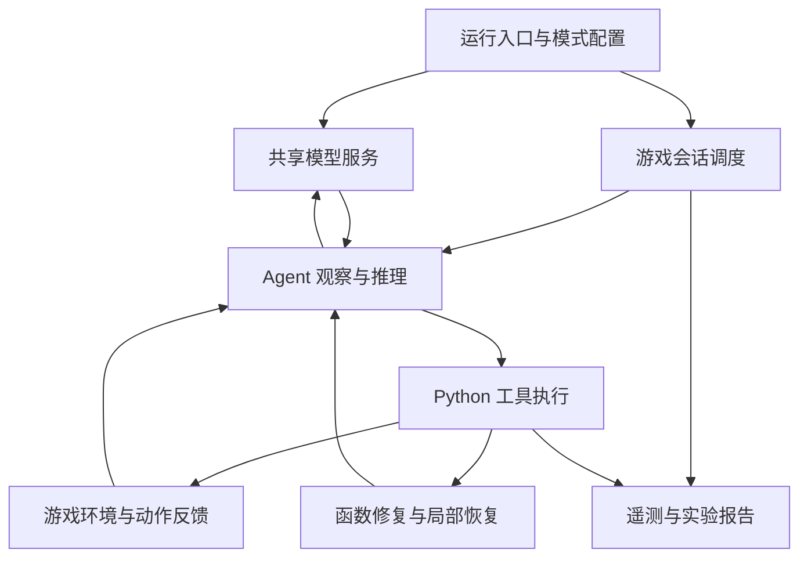

# ARC3 Agent 推理系统

**作者：陈守杰（Clair-ChenShoujie）**

面向 ARC-AGI-3 交互式推理任务，我实现了一套单卡离线 Agent 系统，将大模型推理服务、Python 工具执行、会话状态管理、局部恢复策略与实验观测串成完整运行流程。

当前归档对应 **Kaggle Public Score 24.59** 的实现，作为后续 Agent Infra 与推理系统优化的基线。

## 版本与入口

| 项目 | 内容 |
|---|---|
| 代码入口 | [arc3_2459.ipynb](arc3_2459.ipynb) |
| Kaggle Notebook | [notebook06e2a38c0a / Version 1](https://www.kaggle.com/code/clairechenxyz/notebook06e2a38c0a?scriptVersionId=356766364) |
| Script Version ID | `356766364` |
| 官方提交成绩 | **24.59** |
| 运行硬件 | NVIDIA RTX PRO 6000 |
| 默认开发模式 | `lf52` 单游戏、5分钟 smoke test |
| 正式策略配置 | `noop_recovery_v91` |
| 归档日期 | 2026-10-23 |

代码以单个 Notebook 交付，包含全部 **13个代码单元**：配置、内嵌 harness patch、离线环境初始化、模型启动、实验运行器、监控和评测入口。归档保留代码与执行顺序，移除历史运行输出；本文统一提供项目与运行说明。

## 系统架构



### 1. 单卡离线推理服务

使用 SGLang / Pennyroyal v2.5.3 部署 Qwen3.8-Flash-Next，结合 W4A16 权重量化、FP8 KV Cache、NEXTN/MTP 投机解码、分块预填充和 CUDA Graph，在单卡上承载长上下文 Agent 请求。

启动流程包含模型分片校验、checkpoint 预读取、离线依赖安装、Python 3.12 解释器选择、虚拟环境兼容性检查及服务启动诊断。

| 推理配置 | 当前值 |
|---|---:|
| 服务上下文长度 | 139264 tokens |
| Agent 上下文窗口 | 131072 tokens |
| 上下文 drain 阈值 | 59392 tokens |
| 最大运行请求数 | 10 |
| 活跃游戏流上限 | 10 |
| Chunked prefill | 8192 |
| 静态显存比例 | 0.96 |
| KV Cache 类型 | fp8_e4m3 |
| CUDA Graph 最大 decode batch | 10 |
| 调度策略 | lpm |
| MTP steps | 3 |

游戏会话数量、活跃游戏流和推理引擎请求数是三个独立配置。正式运行通过调度器组织会话，再由共享服务执行模型请求。

### 2. Agent 工具执行与状态管理

Agent 根据当前画面与历史动作反馈进行推理，生成 Python 工具调用，执行动作并读取新状态。实现围绕长程执行中的函数可用性、状态一致性和重复无效操作展开：

- **Function Repair**：为工具执行中的函数问题提供修复路径。
- **持久化函数作用域**：按 game 管理 helper 生命周期。
- **会话隔离**：切换 game/session 时重置局部恢复历史与 checkpoint 状态。
- **局部无效动作恢复**：从真实动作反馈统计 no-op，在局部停滞时向下一轮 prompt 加入恢复提示。

当前正式 profile 开启 Function Repair 与 No-op Recovery v9.1，关闭全局 Step Verification、旧版 Hypothesis/Cycle Switching 及 shadow/strategy diagnostics。

### 3. No-op Recovery v9.1

当前 level 已执行至少24个真实动作后，检查最近最多24个动作的窗口。窗口至少包含16个动作、至少4个 no-op，且 no-op 比例达到0.18时，触发一次局部恢复提示。

同一 game/session 的同一 level 最多触发一次；最新动作导致 game-over 时跳过。恢复提示引导 Agent 重新结合画面与动作效果定位问题，并尝试有区别的 probe。该模块本身不执行动作或 RESET。

### 4. 实验运行与可观测性

实验运行器复用共享模型服务，为各实验组启动独立 worker，等待模型就绪后计入开发测试预算，并记录缓存刷新状态。

观测数据覆盖游戏结果、动作数量、模型 tokens、工具错误、no-op、函数保留问题、checkpoint 事件及排队耗时。系统监控线程独立采集 RAM、GPU显存、磁盘、线程和文件描述符，便于定位长时间运行中的资源问题。

主要输出包括：

| 输出 | 用途 |
|---|---|
| `comparison.csv` | 实验组汇总 |
| `per_game.csv` | 逐游戏指标 |
| `paired_delta.csv` / `pairwise_summary.json` | 配对实验比较（对应模式生成时） |
| `telemetry.jsonl` | 执行事件记录 |
| `effective_config.json` | 实际生效配置 |
| `run.log` | worker 日志 |
| 游戏轨迹与诊断页面 | 回看执行过程 |

## 如何运行

### 环境与输入

在 Kaggle 中导入 Notebook，选择 **GPU RTX PRO 6000**，保留以下五项输入：

1. ARC Prize 2026 - ARC-AGI-3 competition。
2. `pennyroyal-v253` 离线依赖包。
3. `TAAF Kaggle Source Bundle (copy)`。
4. `Intel-Qwen3.8-Flash-Next-W4A16-AutoRound`，Version 1。
5. `albucino-Qwen3.8-Flash-Next-drafter`，Version 1。

最方便的复现方式是在上面的固定版本页面复制 Notebook，保留输入挂载，再导入本仓库代码。模型权重、wheelhouse、competition 环境及原始 source bundle 由 Kaggle inputs 提供。

推理环境需要 Python 3.12。启动代码会查找可用解释器；也可通过 `ARC3_INFERENCE_PYTHON` 指向已挂载的兼容解释器。

### 快速检查

默认首个配置单元为：

```python
DEV_MODE = "smoke"
SUBMISSION_PROFILE = "noop_recovery_v91"
DEV_PROFILES = ("noop_recovery_v91",)
DEV_GAME_PREFIXES = ("lf52",)
DEV_MINUTES_PER_ARM = 5
DEV_REPEATS = 1
DEV_ACTIVE_STREAMS = 1
```

依序 Run All。模型加载与准备完成后执行5分钟游戏测试，再生成实验报告。

### 完整评测与正式提交

- 开发完整评测：将 `DEV_MODE` 设为 `"full"`，检查游戏数、passes及预算后运行。
- 正式比赛：由 Kaggle competition rerun 设置 `KAGGLE_IS_COMPETITION_RERUN`，代码自动切换到 gateway、正式 profile 与比赛调度。
- 开发运行生成的占位 `submission.parquet` 仅用于 Notebook 输出流程；正式成绩由 competition rerun 产生。
- 24.59 是固定版本的官方 Public Score；页面中的5分钟 smoke 输出是另一种测试口径。

## 代码导航

以下编号仅计算代码单元，从1开始：

| 单元 | 内容 |
|---|---|
| 1 | 开发模式与正式 profile |
| 2 | 内嵌 `harness-changes.patch` |
| 3 | 路径、环境变量、补丁应用与运行模式 |
| 4 | checkpoint 预缓存 |
| 5 | 安装 ARC runtime |
| 6 | 导入 source bundle |
| 7 | Pennyroyal 推理服务启动 |
| 8 | `arc3_experiment.py` 实验运行器与遥测 |
| 9 | 加载 benchmark |
| 10 | 并发、passes、单局时间等配置 |
| 11 | 系统资源监控 |
| 12 | 开发实验或正式 benchmark 执行 |
| 13 | 结果表与诊断展示 |

## 工程定位

这个项目聚焦 **长程 Agent 的推理运行时与实验基础设施**：离线部署、共享模型服务、资源调度、工具执行可靠性、状态隔离与可观测性。

后续优化围绕缓存感知调度、固定轨迹回放、TTFT/TPOT及尾延迟测量展开。当前24.59版本作为冻结基线，便于对照后续改动。

## 上游项目与依赖

- [Tufa Labs Duck harness](https://github.com/Tufalabs/duck-harness)，原 Notebook 标注的 patch 基线为 `7652836`。
- [Daniel Franzen ARC-AGI-3 solution](https://github.com/da-fr/arc-agi-3-solution)。
- [Pennyroyal / SGLang RTX PRO 6000](https://github.com/jpezzulli/sglang-rtxpro6000)，v2.5.3，原 Notebook 标注 commit `d00d88efc8d6281b12be4f4073126aec95038c55`。
- [Qwen3.8-Flash-Next](https://huggingface.co/Qwen/Qwen3.8-Flash-Next) 与 [Intel AutoRound W4A16 checkpoint](https://huggingface.co/Intel/Qwen3.8-Flash-Next-W4A16-AutoRound)。
- Albucino MTP draft checkpoint；相关推理补丁来自 [Mamy Ratsimbazafy](https://github.com/mratsim/sglang-qwen38fn-sm120-turbo) 与 [Gabriel Olympie](https://github.com/gabrielolympie/sglang-flashnext-sm120)。

第三方源码、模型权重及数据遵循各自许可证。
