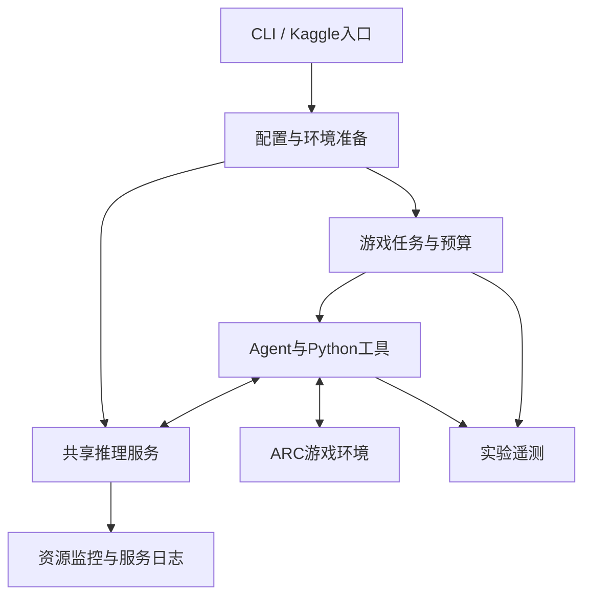

# 系统设计

## 分层

`__main__.py`负责生命周期，`environment.py`准备可写bundle和策略环境，`runtime.py`注册依赖，`precache.py`预读模型，`serving.py`启动推理引擎，`benchmark.py`选择开发实验或完整运行。

`experiment.py`负责独立worker、game选择、开发预算、Telemetry和统计报告。`monitor.py`独立运行，不依赖游戏循环继续推进。

## 推理配置

SGLang/Pennyroyal提供W4A16、FP8 KV、NEXTN/MTP、CUDA Graph、Radix Cache与LPM。服务上下文139264 tokens，Agent窗口131072 tokens，drain阈值59392 tokens，prefill chunk为8192，活跃流10，服务运行请求上限10。

客户端配置中的 `vllm` 是兼容适配标签；服务实际通过 `sglang serve` 启动。

## Agent可靠性

正式profile为`noop_recovery_v91`：函数修复、game作用域的持久helper、game/session隔离、基于真实action的局部no-op恢复。旧cycle策略保留为可选实验配置。

No-op恢复要求level至少24个真实action；最近最多24个action的窗口至少16个有效记录、4个no-op且比例至少0.18。每个session/level最多触发一次；最新action为game-over时跳过。

## 上游依赖

- [Tufa Labs Duck harness](https://github.com/Tufalabs/duck-harness)，patch来源基线`7652836`。
- [Daniel Franzen ARC-AGI-3 solution](https://github.com/da-fr/arc-agi-3-solution)。
- [Pennyroyal / SGLang RTX PRO 6000](https://github.com/jpezzulli/sglang-rtxpro6000)，v2.5.3，commit `d00d88efc8d6281b12be4f4073126aec95038c55`。
- [Qwen3.8-Flash-Next](https://huggingface.co/Qwen/Qwen3.8-Flash-Next)、Intel AutoRound量化与Albucino MTP drafter。
- 推理补丁贡献：[Mamy Ratsimbazafy](https://github.com/mratsim/sglang-qwen38fn-sm120-turbo)、[Gabriel Olympie](https://github.com/gabrielolympie/sglang-flashnext-sm120)。

第三方源码、权重和数据遵循各自许可证。
